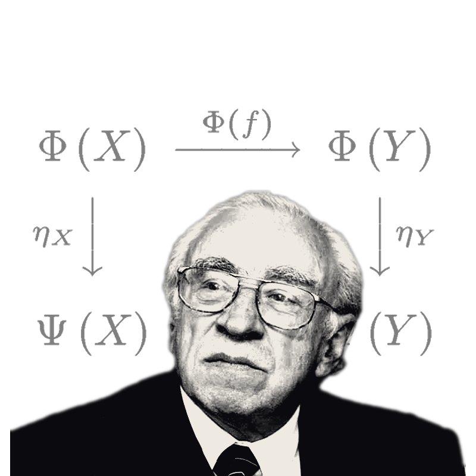

# sarmiento-plugins

  

> **Mission.** Formalise Eduardo Sarmiento mathematically. This repository turns the Colombian
> economist's structuralist claims — demand regime, markup and income distribution, the external
> constraint, productive structure — into typed, dimensionally-checked objects, and ships them as a
> **Colombian plugin to a neo-Kaleckian model**: a concrete instance of the generic `KaleckianKernel`
> owned by [`kalecky-semantics`](https://github.com/JMSBPP/kalecky-semantics). Sarmiento stops being
> prose and becomes a plugin over a reusable kernel.
